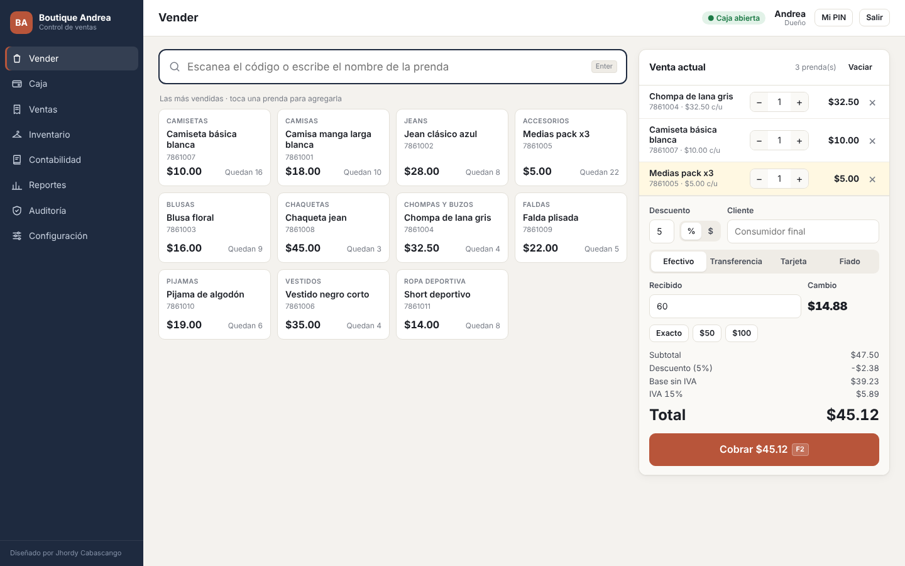
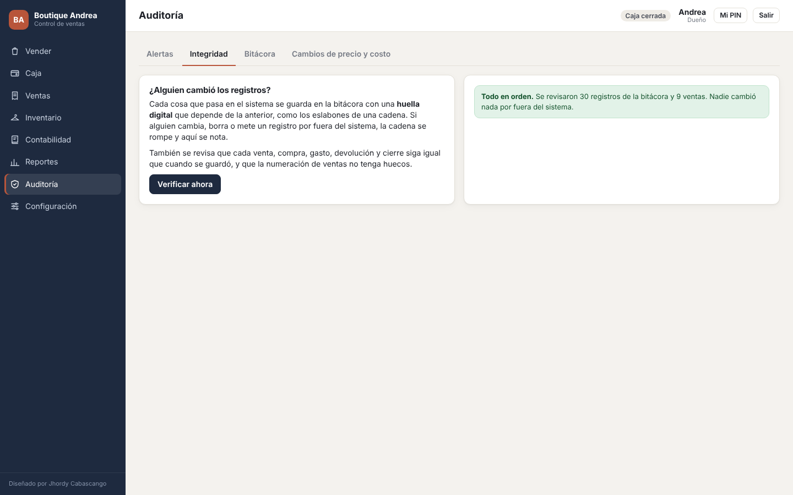
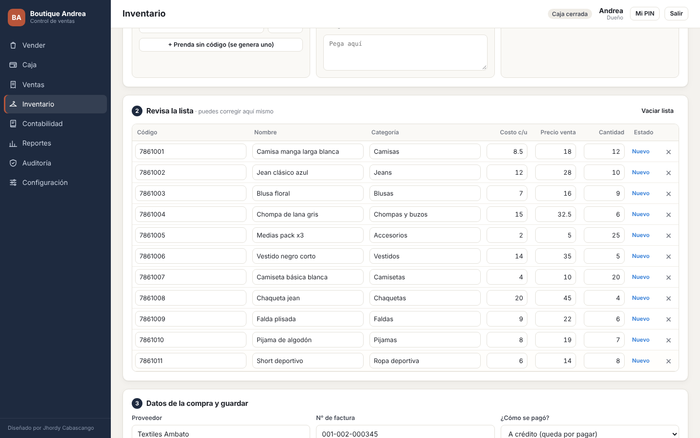
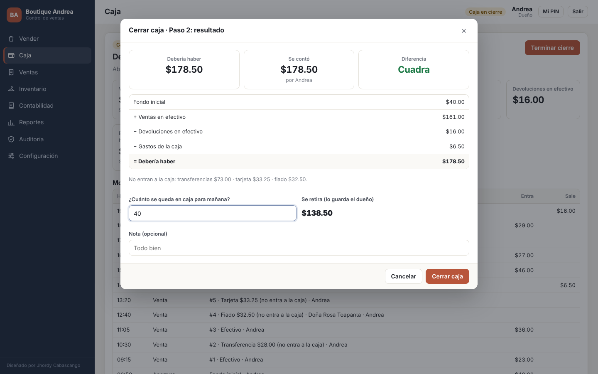
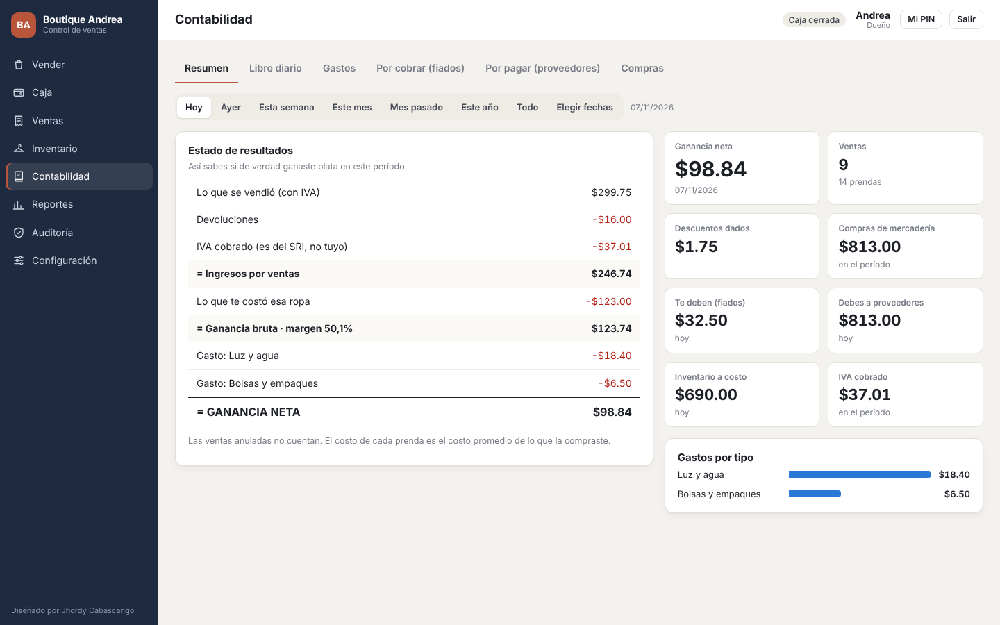
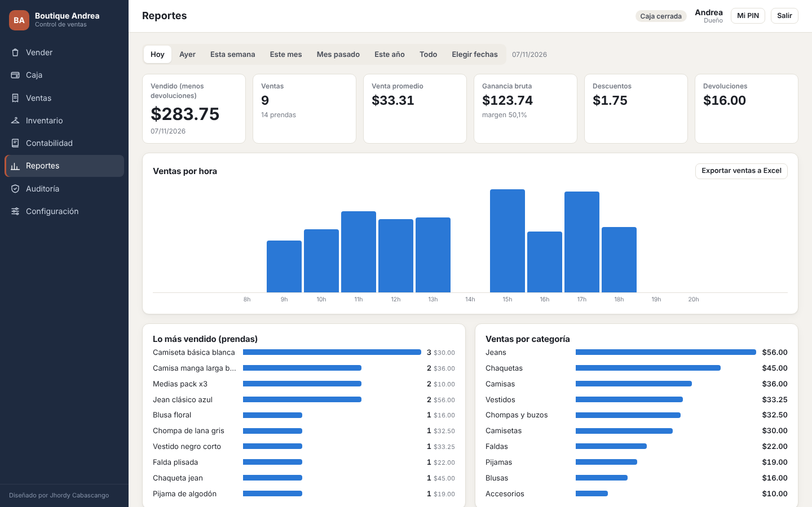
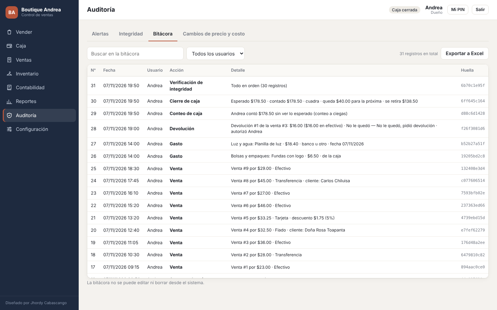

# 👕 Sistema de Ventas y Contabilidad para Locales de Ropa

Sistema para controlar las ventas, la caja, el inventario y la contabilidad de un local de ropa.
Pensado para negocios pequeños del Ecuador: maneja dólares, IVA configurable y fiados.

Es **una sola página web** que funciona **sin internet** y **sin instalar nada**: le das doble clic y se abre en el navegador.

> Diseñado por **Jhordy Cabascango** · TikTok [@mr_jhordy21](https://www.tiktok.com/@mr_jhordy21)



---

## ¿Qué hace?

**Ventas**
- Vende escaneando el código con un lector o tocando la prenda en pantalla.
- Cobra en efectivo (calcula el cambio), por transferencia, con tarjeta o fiado.
- Permite descuentos en porcentaje o en dólares.
- Imprime un ticket con un código de verificación.
- Registra devoluciones y cambios. Una venta se puede anular, pero nunca se borra.

**Inventario**
- Carga la mercadería rápido: pegando desde Excel, con el lector de códigos o subiendo un archivo CSV.
- Lleva el historial de cada prenda: cuándo entró, cuándo se vendió y cuándo se ajustó.
- Calcula el costo promedio cuando compras la misma prenda a distintos precios.
- Tiene conteo físico: cuentas la ropa sin ver lo que dice el sistema y te muestra lo que falta o lo que sobra.

**Caja**
- Se abre cada día con el dinero inicial.
- Registra gastos pequeños, además del dinero que se mete o se saca de la caja.
- El cierre es **a ciegas**: se cuentan billetes y monedas sin ver cuánto debería haber, y después el sistema muestra si cuadra, si falta o si sobra.

**Contabilidad**
- Estado de resultados: te dice si de verdad ganaste plata (ventas − IVA − costo de la ropa − gastos).
- Libro diario con todo el dinero que entra y sale.
- Lista de los clientes que te deben (fiados) y de lo que tú debes a los proveedores.
- Exporta los reportes a Excel.

**Reportes**
- Ventas por hora, por día o por mes.
- Lo más vendido y las ventas por categoría, por vendedor y por forma de pago.
- **Plata parada**: la ropa que no se vende hace tiempo.
- Las prendas que hay que reponer.

---

## 🔍 Control antifraude (análisis forense)

El sistema sigue 5 reglas para que nadie pueda esconder un robo o un error:

1. **Nada se borra.** Las ventas y los gastos se anulan con un motivo y siguen a la vista.
2. **Todo tiene dueño.** Cada persona entra con su propio PIN y cada acción guarda quién la hizo y a qué hora.
3. **Números seguidos.** Las ventas van 1, 2, 3… Si falta un número, el sistema lo detecta.
4. **Funciones separadas.** El vendedor no puede anular, devolver, sacar dinero de la caja, cambiar precios ni ajustar el inventario sin el PIN del dueño.
5. **Conteo a ciegas.** Tanto en la caja como en el inventario.

Además:
- Cada movimiento se guarda en una **bitácora** con una huella digital (SHA-256) encadenada a la anterior. Si alguien cambia los datos por fuera del sistema, la cadena se rompe y la verificación lo muestra.
- El sistema muestra **alertas automáticas** cuando ve algo raro. Por ejemplo:
  - muchas anulaciones de un mismo vendedor;
  - faltantes o sobrantes en la caja;
  - ventas por debajo del costo o fuera de horario;
  - el truco de bajar un precio, vender y volver a subirlo.



---

## 🚀 Cómo usarlo

1. Descarga el archivo `index.html`.
2. Ábrelo con doble clic en **Google Chrome** o **Microsoft Edge**.
3. La primera vez escribe el nombre del local, tu nombre y crea tu PIN de dueño.
4. Carga tu mercadería en **Inventario → Cargar mercadería**.
5. Abre la caja y empieza a vender.

### Cargar el inventario rápido

En Excel, organiza las columnas en este orden:

| Código | Nombre | Categoría | Costo | Precio | Cantidad | Stock mínimo |
|---|---|---|---|---|---|---|
| 7861001 | Camisa manga larga blanca | Camisas | 8,50 | 18,00 | 12 | 3 |
| | Jean clásico azul | Jeans | 12,00 | 28,00 | 10 | 3 |

- Copia las filas y pégalas en el sistema con **Ctrl + V**. Se leen solas.
- Si una prenda no tiene código, déjalo vacío y el sistema le crea uno.
- Para reponer una prenda que ya existe, basta con poner **Código** y **Cantidad**.
- En este repositorio está la plantilla [`plantilla-inventario.csv`](plantilla-inventario.csv).



### Usuarios

| Puede… | Dueño | Vendedor |
|---|:---:|:---:|
| Vender y cobrar | ✅ | ✅ |
| Abrir, cerrar caja y registrar gastos pequeños | ✅ | ✅ |
| Ver precios y stock | ✅ | ✅ |
| Anular, devolver o sacar dinero de la caja | ✅ | Con PIN del dueño |
| Dar más descuento del permitido o vender bajo el costo | ✅ | Con PIN del dueño |
| Cargar mercadería, cambiar precios, ajustar inventario | ✅ | ❌ |
| Ver contabilidad, reportes y auditoría | ✅ | ❌ |

---

## 💾 Importante: respaldos

Los datos se guardan **en el navegador de la computadora donde se usa** (no en internet).
Si se borra el historial del navegador o se daña la PC, se pierden.

👉 Descarga un respaldo cada día desde **Configuración → Respaldos** y guárdalo en una USB o en tu correo.
Con ese archivo puedes recuperar todo, incluso en otra computadora.

---

## 🌐 Publicarlo con GitHub Pages (opcional)

1. En el repositorio entra a **Settings → Pages**.
2. En *Branch* elige `main` y la carpeta `/ (root)`, y presiona **Save**.
3. En un par de minutos el sistema queda en `https://TU-USUARIO.github.io/sistema-ventas-ropa/`.

Aunque se abra desde esa página, los datos se siguen guardando en el navegador de cada computadora.

---

## 📸 Capturas

| Cierre de caja | Contabilidad |
|---|---|
|  |  |

| Reportes | Bitácora |
|---|---|
|  |  |

---

## 🛠️ Tecnologías

- **HTML, CSS y JavaScript** puro, sin librerías ni internet.
- **IndexedDB** para guardar los datos en el navegador.
- **SHA-256** para la huella digital de la bitácora.

## 📁 Estructura

```
sistema-ventas-ropa/
├── index.html                 ← el sistema completo
├── plantilla-inventario.csv   ← plantilla para cargar mercadería
├── capturas/                  ← imágenes del README
└── README.md
```

## ⚠️ Notas

- El ticket es un **comprobante interno**, no es una factura electrónica del SRI.
- El IVA se puede cambiar en **Configuración**. Revisa que sea el porcentaje vigente.
- El sistema no maneja tallas ni colores: cada prenda tiene un solo código y un solo stock.

---

## 👤 Autor

**Jhordy Mauricio Cabascango Cabascango**

- TikTok: [@mr_jhordy21](https://www.tiktok.com/@mr_jhordy21)
- GitHub: [jhomac2](https://github.com/jhomac2)

Si te sirvió, dale ⭐ al repositorio y sígueme en TikTok.
